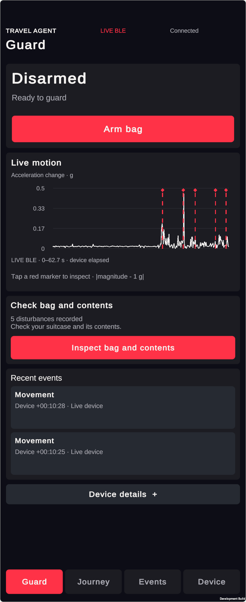
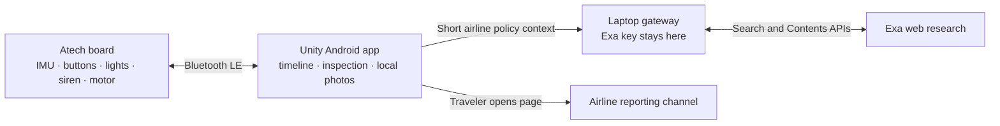

# TravelAgent / CrumbGuard

A suitcase alarm, a live motion timeline, and an Exa assistant that helps a traveler take the next step after finding damaged baggage.

Built for Junction 2026 with an Atech ESP32-S3 kit, a Unity Android app and a small laptop gateway. The traveler checks the bag and decides whether damage exists. Exa researches the airline's reporting process and required evidence; the app then opens the airline's reporting channel.

## The demonstration

1. Share selected boarding-confirmation text from Gmail to TravelAgent. The app reads supported airline and route details locally.
2. Move the connected, Disarmed bag. The measured trace updates and red movement markers open event details.
3. Inspect the suitcase and contents, then explicitly record whether damage was found.
4. Tap **Find reporting steps with Exa** to retrieve sourced airline instructions and photo requirements.
5. Take local evidence photos and continue to the airline's reporting page. Nothing is submitted automatically.

The Finnair case is a demonstration of the reporting flow. Neither the app nor Exa analyses photographs or infers damage from motion.

## Run it

- **Without hardware:** open `app/` in **Unity 6000.6.9f1**, open `Assets/_App/Scenes/App.unity`, and press Play. Demo hardware and labelled fixture guidance work without credentials.
- **With the real prototype:** use the Android app, the current Atech firmware and the laptop Exa gateway. Start the Windows gateway using `app/TravelAgent Demo.cmd` and wait for **Laptop connection ready**.
- Follow [Setup](docs/SETUP.md), [Hardware](docs/HARDWARE.md) and the [two-minute demo route](docs/DEMO.md).

The saved presentation configuration starts a blank trip and timeline after a full app close/reopen. Returning from Home, Gmail or the camera retains the current run. Pairing, board codes and gateway settings stay saved.

## How it fits together

See [Architecture](docs/ARCHITECTURE.md) for data boundaries and protocol behavior.

## Repository contents

| Path | Contents |
| --- | --- |
| `app/` | Editable Unity project, Android Java plugin, Python Exa gateway, Windows launcher and software tests |
| `firmware/` | Current board source, required custom modules and build instructions |
| `hardware-tools/` | Host-side firmware harness source and stubs |
| `mechanical/` | Actual case/dispenser STL print layouts, mesh inventory and preview; editable Fusion source can be added later |
| `docs/` | Setup, architecture, demo, validation and submission notes |
| `media/` | Selected screenshots suitable for public documentation |
| `dist/` | Local binary staging only; excluded from Git and intended for release downloads |

## What is verified—and what remains

The real board has streamed motion into the phone, produced selectable movement markers while Disarmed, and completed a quiet Arm/Armed/Disarm check. The latest app build passes **213 EditMode and 49 PlayMode tests** and its fresh-launch behavior was checked on an Android phone. [Testing](docs/TESTING.md) separates each build's source and physical acceptance.

This is a hackathon prototype. The timeline records connected sessions only: device-side offline storage/backfill, variable resolution and quiet transit recording are future work. Loaded breadcrumb dispensing and prolonged alarm cutoff were not validated in the assembled demonstration. The app does not determine damage, liability, compensation or reporting deadlines.

## Submission and licensing

Source repository: [Tobiansen/travelagent-crumbguard](https://github.com/Tobiansen/travelagent-crumbguard). The Unity app, gateway/launcher, current firmware source and actual STL print layouts are collected here. An APK download release is being prepared. The firmware binary remains local while upstream build/redistribution materials are reviewed; its source is included. See [Release files](docs/RELEASES.md) for hashes and availability. The demo-video link and event submission remain separate handoff items in [Submission notes](docs/SUBMISSION.md).

Team-authored work is covered by [LICENSE](LICENSE). Third-party components retain their own notices in `third_party/` and within the source. Atech reference geometry must not be represented as team-authored MIT material.
