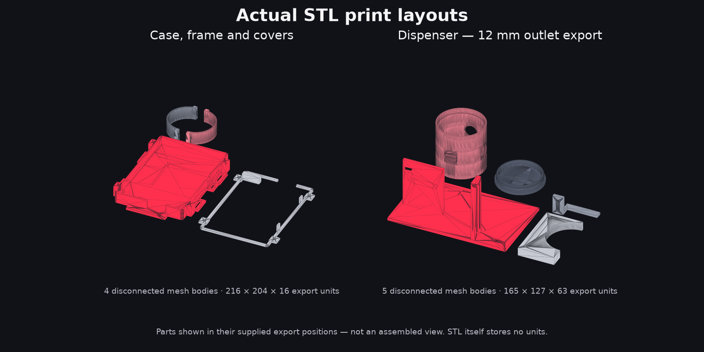

# Mechanical design

The assembled prototype uses a suitcase-mounted enclosure and a horizontally
rotating perforated breadcrumb drum with a separately wired motor mount.

The two STL files below were supplied as the exports used for the assembled
prototype. Their original bytes and filenames are preserved. The older mechanical
proposal is deliberately not included.

## Print files

| File | Mesh bodies | Triangles | Overall export extents |
| --- | ---: | ---: | --- |
| [01_case_frame_covers.stl](stl/01_case_frame_covers.stl) | 4 | 5,972 | 216 × 204 × 16 |
| [02_dispenser_12mm_outlets.stl](stl/02_dispenser_12mm_outlets.stl) | 5 | 12,954 | 165 × 127 × 63 |

Each file is a **multi-body print layout**, rather than one STL per individual
part. Both parse successfully and their mesh surfaces are watertight. Body counts
describe disconnected mesh shells, not independently certified printable parts.
The name of the second export records the intended 12 mm outlets; no physical
hole measurement is asserted here.

STL has no unit metadata. The project's Fusion handoff uses millimetres; import
consistently as mm and verify the scale in the slicer. The first layout's large
case body is about 106 × 136 × 14 in export coordinates. Preserve the supplied
layout, or split bodies deliberately in the slicer. Material, layer height,
supports and assembly hardware used for the actual print were not recorded here.



Detailed bounds, connected bodies and SHA-256 values are in
[mesh-inventory.json](mesh-inventory.json). Geometry checks do not establish
fit, strength, jam resistance or loaded crumb dispensing performance.

## Editable design

The editable Fusion `.f3d` / `.f3z` and optional STEP export have not yet been
provided. The print files are included now; editable source can be added later:

```text
mechanical/
  stl/       # The two supplied multi-body print layouts
  source/    # Editable Fusion .f3d, or .f3z for linked components
  step/      # Optional neutral CAD export
  images/    # Optional assembly photo or exploded view
```

STLs support reprinting. The editable CAD is recommended for modifying fit and
dimensions. These are reproducibility recommendations, not an assertion that
every hackathon requires these formats.

Upstream Atech reference meshes are not included. If a Fusion archive contains
those imported components, identify them separately and preserve their
CC BY-NC 4.0 attribution; see [third-party notices](../THIRD_PARTY_NOTICES.md).
